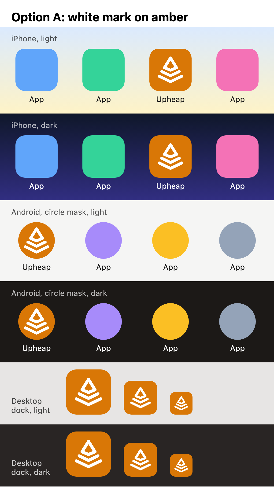
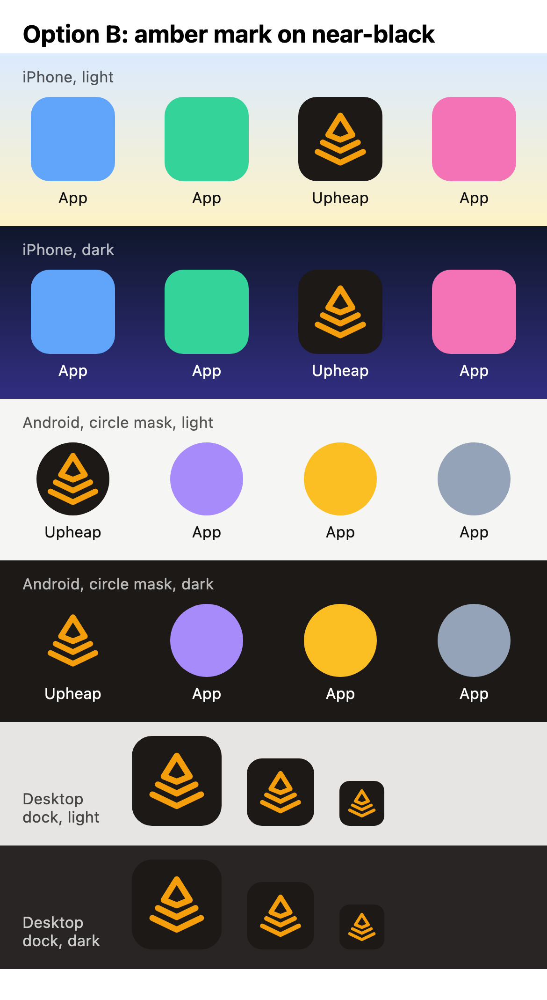
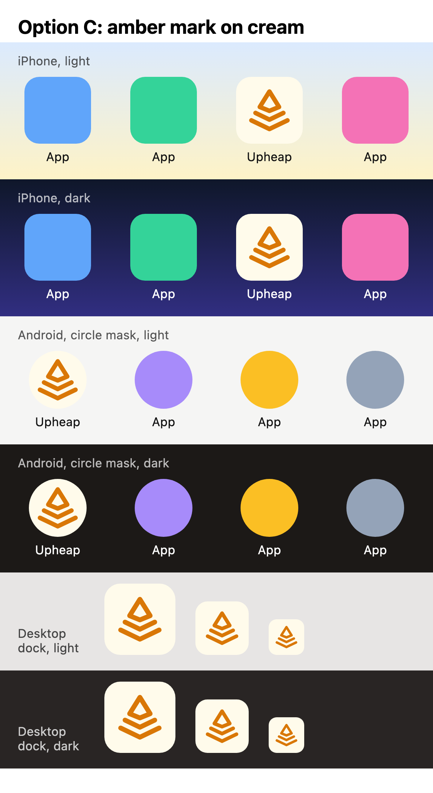

# App icon options (8s2cw)

For review only. This branch isn't merged: once an option is picked, its PNGs go into `web/public/` on the feature branch.

All three use the current mark (the favicon's three paths) with a heavier stroke (2.2 instead of 1.9 on the 24-unit grid), so it holds up at home-screen size. They differ only in colour.

| Option | Background | Mark |
| --- | --- | --- |
| A | amber `#d97706` (light `--accent`) | white |
| B | near-black `#1c1917` (`--ink`) | amber `#f59e0b` (dark `--accent`) |
| C | cream `#fffbeb` (`--accent-soft`) | amber `#d97706` |

Each preview is a 390 px-wide phone screen at 3x. On a phone, open it full width to see the icons at about real size: 60 pt on iOS, 52 dp in Android's circle mask, and 64, 48 and 32 px on a desktop dock.

## Option A: white mark on amber

## Option B: amber mark on near-black

## Option C: amber mark on cream

## Files per option

- `<option>-any-192.png`, `<option>-any-512.png`: Android and desktop Chrome or Edge. A rounded tile with clear corners.
- `<option>-maskable-512.png`: full bleed. The mark sits well inside the central 80% safe circle, so Android can crop it to any shape.
- `<option>-apple-180.png`: `apple-touch-icon`. A full square, because iOS rounds the corners itself.
- `<option>-*.svg`: the sources.
